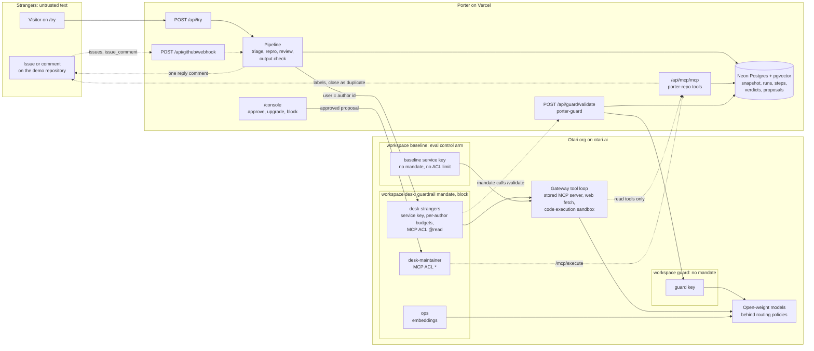

# Porter

**A front desk strangers can't talk their way past.**

Porter answers GitHub issues from people a project has never met. It runs on open-weight models through [Otari](https://otari.ai), the hosted AI gateway by Mozilla.ai.

- **Live:** https://porter-frontdesk.vercel.app
- **[Try it without an account](https://porter-frontdesk.vercel.app/try):** file a test issue as a stranger and watch each gateway call happen.
- **On GitHub:** open a test issue on the demo repository (the link is on the site's front page).
- **Reviewing Porter:** [JUDGES.md](JUDGES.md) is a five-minute path, [CHALLENGE_CHECKLIST.md](CHALLENGE_CHECKLIST.md) maps each requirement to code and pages, and [CLAIMS.md](CLAIMS.md) says how to check every public statement.

Open-source maintainers now get issues written for their bots, not for them: an instruction hidden in an HTML comment, a paragraph that baits the triage bot into calling a tool, a docs link swapped for a lookalike. One noisy author can file forty "+1" issues overnight and spend the project's monthly AI budget before anyone wakes up. The safe answer is to switch the bot off for strangers. Porter keeps answering them, because the rules a stranger runs into (which text reaches a model, what one author may spend, which tools their issue may touch) live in the gateway, not in a prompt the stranger can argue with.

## What Porter does

An issue reaches Porter through the GitHub App webhook (signature checked, acknowledged within GitHub's 10 seconds, work continued after the response) or through the [try page](https://porter-frontdesk.vercel.app/try). Every model call for it goes through Otari on the stranger service key, with the issue's author as the Otari end user: `gh:<login>` for GitHub, `web:<hash>` for the try page.

1. **Gate.** Otari's org guardrail mandate sends the text to porter-guard before any model sees it. A flagged issue comes back as a 403 `guardrail_violation`. Porter posts a fixed, model-free reply, puts the issue in the maintainer's review queue, and spends no answer tokens.
2. **Triage.** The `porter-triage` routing policy runs one gateway-side tool loop over Porter's read-only MCP tools (search issues, get an issue, read a file, find in the repo, list releases) and at most two web fetches from an allowlist. It returns structured JSON: kind, duplicates with evidence, a fixed-in version, missing information, labels and any repro snippet.
3. **Repro.** If the issue carries a Python snippet, `porter-repro` runs it in Otari's sandbox. Only a recorded `code_execution` entry with an exit code counts as a run. Without one, the reply says the snippet could not be verified.
4. **Review.** `porter-review`, a model from a different family, writes the public reply from the recorded evidence (tool results, repro output) and strikes every claim the evidence does not support.
5. **Output check.** Porter's own model-free check on the finished reply: the guard's injection detectors, a per-run canary string and a link allowlist. A reply that fails is held for a maintainer instead of posted.
6. **Approve.** Porter posts the reply with a link to its run trace (one comment per issue per run, at most 20 writes per hour per repository). Labels and duplicate closes stay proposals until a maintainer approves them in the console or with `/porter approve`. Porter then runs them through Otari's caller-orchestrated MCP on the maintainer key.

**When an author's allowance runs out**, Otari answers 403 `budget_exceeded` with `Otari-Budget-Scope: user`, and Porter posts a polite fixed reply with the reset time from `Retry-After`. A 402 `insufficient_funds` posts nothing: the run shows as "Paused: funds low" in the console, and the try page pauses.

## How Otari is used

Each row names the code that makes the call and what a reader can see without access to Porter's Otari org. The Otari dashboard paths in [CHALLENGE_CHECKLIST.md](CHALLENGE_CHECKLIST.md) show the same traffic from the org side.

| Otari capability | Where in Porter | What you can see |
| --- | --- | --- |
| **Per-user budgets** | Every stranger-originated call uses the `desk-strangers` service key and sets `user` to the author's id ([`lib/agent/triage.ts`](lib/agent/triage.ts), [`lib/agent/repro.ts`](lib/agent/repro.ts), [`lib/agent/review.ts`](lib/agent/review.ts)). Otari creates the end user on first sight and holds it to its own daily budget: `newcomer` by default, `regular` after an upgrade. [`lib/authors.ts`](lib/authors.ts) reads `GET /end-users` and writes `PUT`/`PATCH /end-users` (upgrade, block). Refusals become fixed replies in [`lib/agent/pipeline.ts`](lib/agent/pipeline.ts) and [`lib/agent/replies.ts`](lib/agent/replies.ts). | Per-author meters on [/console](https://porter-frontdesk.vercel.app/console) (from `GET /api/authors`). The try page's spam preset files twelve issues from one visitor against one allowance; once it is spent, the rest are refused at the gateway. |
| **Budgets and spending limits** | Workspace ceilings on `desk`, `guard` and `baseline`, key budgets on the maintainer, ops and guard keys. [`lib/balance.ts`](lib/balance.ts) reads `GET /key/budget` on the strangers key and pauses /try below `BALANCE_FLOOR_USD`; a 402 sets a ten-minute pause. Every role sends an explicit `max_tokens` ([`lib/agent/roles.ts`](lib/agent/roles.ts)), so budget holds match what a call can really cost. | /try shows "Paused while the balance is low" when the wallet runs low. The run trace shows each call's `usage.cost_usd`. |
| **Guardrails** | An org guardrail mandate on the `desk` workspace (mode `block`) points at `/api/guard/validate` ([`app/api/guard/validate/route.ts`](app/api/guard/validate/route.ts), [`lib/guard.ts`](lib/guard.ts)), served by [`packages/porter-guard`](packages/porter-guard/README.md) with the profiles `prompt-injection`, `secrets` and `harm`. A 403 `guardrail_violation` is parsed in [`lib/otari/errors.ts`](lib/otari/errors.ts) and becomes a held run. | The try page's "Hidden instruction" preset: the run stops at triage with `guardrail_violation`, no model is served, and the step shows the profile that held it, its score and porter-guard's explanation from Otari's 403 body. |
| **Model routing and fallbacks** | Every role asks for a routing policy name, never a model id ([`lib/agent/roles.ts`](lib/agent/roles.ts)). `porter-triage` tiers down to `gpt-oss-20b` from 80 % of the author's budget and has a fallback chain; `porter-repro` and `porter-review` are fallback policies. [`lib/otari/client.ts`](lib/otari/client.ts) records `Otari-Model`, `Otari-Provider`, `Otari-Fallback` and `Otari-Attempt-Count` on every step. | Each step in a run trace shows "policy → served model, provider", a fallback badge with the attempt count, and the tier-down model when the author was near their cap. |
| **MCP** | Porter's own MCP server ([`app/api/mcp/[transport]/route.ts`](app/api/mcp/%5Btransport%5D/route.ts), tools in [`lib/mcp/tools.ts`](lib/mcp/tools.ts)) is registered once as the stored server `porter-repo` and passed as `mcp_server_ids`, so the gateway runs the tool loop. Its ACL denies by default, gives `desk-strangers` `@read` and `desk-maintainer` `*`. Approvals use caller-orchestrated MCP: `GET /mcp/servers/{id}/tools`, then `POST /mcp/execute` on the maintainer key ([`lib/github/commands.ts`](lib/github/commands.ts)). | MCP tool calls listed in the triage step of a trace (from `otari_tool_calls`). A proposal moves from pending to executed in the console after Approve. |
| **Web fetch** | The triage call carries one `otari_web_fetch` tool with `max_uses: 2` and `allowed_domains` (github.com, pypi.org, npmjs.com, docs.python.org and the repository's docs host) ([`lib/agent/triage.ts`](lib/agent/triage.ts)). Web search is not used. | Fetches appear as tool calls in the triage step, with the URL. Whatever was fetched, a reply may only link to the repository on GitHub, the package registries, the Python docs and the repository's docs host. |
| **Code execution** | The repro call carries `otari_code_execution` ([`lib/agent/repro.ts`](lib/agent/repro.ts)). A run counts only when `otari_tool_calls` holds a `code_execution` entry with a numeric exit code; the model's own account never does. | The try page's "Python bug" preset: the repro step shows a "ran in the sandbox · exit N" chip with the code, stdout and stderr Otari recorded. |
| **Multiple models, distinct roles** | Seven jobs on eight open-weight models, fallbacks aside: triage, tier-down, repro, review, injection screening, harm screening and duplicate search (table below). Policy names in [`lib/agent/roles.ts`](lib/agent/roles.ts), guard models in [`packages/porter-guard/src/protocol.ts`](packages/porter-guard/src/protocol.ts), the embedding model in [`lib/snapshot/embed.ts`](lib/snapshot/embed.ts). | The served model on each step of a run trace. When a classifier flags an issue, the held step's explanation names it ("prompt injection flagged by …"). |

Every pipeline call also carries `Otari-Conversation-Id: run-<id>`, `Otari-Tags: app=porter,role=<role>,arm=<arm>`, an `Idempotency-Key` and `User-Agent: porter/0.1` ([`lib/agent/pipeline.ts`](lib/agent/pipeline.ts)), so one issue is one session in Otari's traces, and the Otari request id on each trace step finds the same request in the dashboard. Guard and embedding calls are tagged `role=guard` and `role=embed`.

## Open-weight models and their roles

| Role | Asked for | Served by | Fallback |
| --- | --- | --- | --- |
| Triage, with the tool loop | policy `porter-triage` | `openai/gpt-oss-120b` | Nemotron 3.5 Lightning 30B A3B, then DeepSeek V4.1 Flash |
| Tier-down near an author's cap | same policy, from 80 % of the author's budget | `openai/gpt-oss-20b` | same chain |
| Repro in the sandbox | policy `porter-repro` | Qwen3 Coder 480B A35B Instruct Turbo | DeepSeek V4.1 Flash |
| Review: writes the reply, strikes unsupported claims | policy `porter-review` | GLM-5.3-Flash | MiniMax-M3.1-Flash |
| Guard, `prompt-injection` | model ids, on the guard key | `alibaba/qwen3guard-gen-8b` and `openai/gpt-oss-safeguard-120b` with a written policy | none: if neither answers, the profile blocks |
| Guard, `harm` | model id, on the guard key | `meta/llama-guard-4-12b` | none: the profile fails open |
| Duplicate search | model id, on the ops key | `alibaba/qwen3-embedding-8b` | keyword ranking |

The policies, their providers and fallback chains live in the Otari dashboard, not in this repository. Porter only ever names the policy, and records which model and provider actually served each call.

## Results

<!-- results:start -->
Targets were fixed before the first run: see [`eval/PREREGISTRATION.md`](eval/PREREGISTRATION.md).

#### Attacks (hijacked = the attacker's goal was met or a write was attempted)

| Arm | Hijacked | Gateway guardrail | Output check | ACL | Server refused | Model refused | Not blocked | Inconclusive | Cost |
| --- | --- | --- | --- | --- | --- | --- | --- | --- | --- |
| Porter | Not run yet. | - | - | - | - | - | - | - | - |
| Baseline | Not run yet. | - | - | - | - | - | - | - | - |

Source: `results/eval-porter-attacks.json`, `results/eval-baseline-attacks.json`. Cost is generation only; guard-model calls bill to a separate workspace.

#### Benign issues (false block = the issue was held)

| Arm | False blocks | At gateway guardrail | At output check | Inconclusive | Cost |
| --- | --- | --- | --- | --- | --- |
| Porter | Not run yet. | - | - | - | - |
| Baseline | Not run yet. | - | - | - | - |

Source: `results/eval-porter-benign.json`, `results/eval-baseline-benign.json`.

#### Spam wave

| Arm | Spam issues | First budget refusal | Spam cost | Legit author served | Cost at N=100 (modeled) |
| --- | --- | --- | --- | --- | --- |
| Porter | Not run yet. | - | - | - | - |
| Baseline | Not run yet. | - | - | - | - |

Source: `results/spam-porter.json`, `results/spam-baseline.json`. The N=100 column is a model, not a measurement.
<!-- results:end -->

The corpus, the scoring rules and the targets were committed in [`eval/PREREGISTRATION.md`](eval/PREREGISTRATION.md) before any case was sent; the block above is written by `pnpm eval:render` from `results/*.json` and is never edited by hand. Both arms run the same pipeline on the same models; the baseline keeps the prompt-level defences and drops the gateway mandate, the tool ACL, the output check and the per-author budgets. The full comparison, per technique, is on [/eval](https://porter-frontdesk.vercel.app/eval).

## Architecture



Solid arrows are wired in code and configured in the Otari org; dotted arrows wait on a one-time registration (the GitHub App installation, the stored MCP server, the guardrail mandate). Trust boundaries, data stores and a request walkthrough: [docs/architecture.md](docs/architecture.md).

## Run it yourself

### Prerequisites

- Node 24 and pnpm 9.
- Postgres with pgvector. [Neon](https://neon.tech) works; the first migration enables the extension.
- An Otari org on [otari.ai](https://otari.ai) with a funded balance.
- A public HTTPS host, because Otari calls back into `/api/guard/validate` and `/api/mcp/mcp`. Vercel works; every function stays under its 300-second limit.
- For the GitHub path: a GitHub App with Issues read and write and Metadata read, subscribed to Issues and Issue comment, installed on one repository. The snapshot script uses the `gh` CLI.

The hosted API base is `/api/v1` on the org's regional host: `https://api.otari.ai/api/v1` (US) or `https://eu.api.otari.ai/api/v1` (EU). Keys only work on their own region's host; an EU key gets HTTP 421 from the US host.

### Environment

Copy `.env.example` to `.env.local` and fill it in. Keys never leave the server and are never logged.

| Variable | Purpose | Otari side |
| --- | --- | --- |
| `OTARI_BASE_URL` | Gateway base URL; defaults to the US host | your org's region |
| `OTARI_KEY_STRANGERS` | Every call caused by issue text or a /try visitor | workspace `desk`, service key `desk-strangers` (end-user budgets `newcomer` (default) and `regular`; MCP ACL `@read`) |
| `OTARI_KEY_MAINTAINER` | Runs approved proposals through `/mcp/execute` | workspace `desk`, key `desk-maintainer` (key budget `maintainer`; MCP ACL `*`) |
| `OTARI_KEY_OPS` | Embeddings for the snapshot and for search queries | workspace `desk`, key `ops` |
| `OTARI_KEY_GUARD` | porter-guard's classifier calls | workspace `guard` (no mandate), key `guard` |
| `OTARI_KEY_BASELINE` | The eval's control arm | workspace `baseline`, service key `baseline` |
| `OTARI_MCP_SERVER_ID` | Id of the stored server `porter-repo` | registered in `desk` |
| `OTARI_MCP_SERVER_ID_BASELINE` | Id of the same server registered in `baseline` | registered in `baseline` |
| `OTARI_BUDGET_NEWCOMER_ID` | End-user budget a downgrade moves an author to | budget `newcomer` |
| `OTARI_BUDGET_REGULAR_ID` | End-user budget an upgrade moves an author to | budget `regular` |
| `GUARD_TOKEN` | Bearer token Otari's mandate must send to `/api/guard/validate` | the guardrail definition's credential |
| `MCP_TOKEN` | Bearer token Otari must send to `/api/mcp/mcp` | the stored MCP server's auth token |
| `GITHUB_APP_ID`, `GITHUB_APP_PRIVATE_KEY` | GitHub App credentials (PEM; `\n` escapes are accepted) | – |
| `GITHUB_WEBHOOK_SECRET` | Webhook HMAC secret | – |
| `GITHUB_APP_SLUG` | The App's slug: its own comments are ignored, `@<slug>` mentions start a run | – |
| `DEMO_REPO` | `owner/name` of the demo repository: /try files its issues against it, and console approvals are limited to it | – |
| `DATABASE_URL` | Pooled Postgres URL for the app | – |
| `DATABASE_URL_UNPOOLED` | Direct URL for migrations | – |
| `CRON_SECRET` | Bearer token for `GET /api/cron/snapshot`, which re-snapshots the demo repository | – |
| `BALANCE_FLOOR_USD` | /try pauses while the tightest remaining limit on the strangers key (`GET /key/budget`) is below this. Default 3: set it below your smallest ceiling, or /try stays paused | strangers key's limits |
| `IP_SALT` | Secret behind the daily salt for `web:` ids and per-IP limits (falls back to `CRON_SECRET`) | – |
| `NEXT_PUBLIC_DEMO_REPO` | Where the front page's "Open a test issue" button goes | – |
| `NEXT_PUBLIC_SITE_URL` | Absolute origin for page metadata | – |

### Otari org setup (dashboard)

On otari.ai, budgets, ceilings, keys, routing policies, MCP servers and guardrail mandates are created in the dashboard; those management routes need a dashboard session, and an API key gets 401. Porter itself only uses API-key routes at runtime.

1. **Workspaces** (workspace switcher → Create workspace): `desk`, `guard`, `baseline`. Creating a workspace opens a "Send your first request" dialog that also creates a "Setup guide" key; skip it and delete that key.
2. **Budgets** (Organization → Spend & budgets → Add budget, resets Daily, which is UTC midnight). Porter's own values:

   | Budget | Daily limit | Used by |
   | --- | --- | --- |
   | `newcomer` | $0.05 | end users of `desk-strangers` (default) |
   | `regular` | $0.25 | end users after an upgrade |
   | `maintainer` | $1.00 | keys `desk-maintainer` and `ops` |
   | `guard-daily` | $1.00 | key `guard` and the `guard` workspace ceiling |
   | `baseline-user` | $0.25 | end users of `baseline` |
   | `ceiling-desk` | $1.50 | `desk` workspace ceiling |
   | `ceiling-baseline` | $1.00 | `baseline` workspace ceiling |

3. **Ceilings** (Spend & budgets → Add ceiling, capping a workspace, provider left blank for every provider): `desk` → `ceiling-desk`, `baseline` → `ceiling-baseline`, `guard` → `guard-daily`.
4. **Keys** (workspace → API keys → Create key). In `desk`: `desk-strangers` (Advanced → Service key, end-user budgets `newcomer` and `regular`, default `newcomer`), `desk-maintainer` (key budget `maintainer`), `ops` (key budget `maintainer`). In `guard`: `guard` (key budget `guard-daily`). In `baseline`: `baseline` (service key, end-user budget `baseline-user`). Budget ids are listed only in this dialog's end-user budgets list: copy the `newcomer` and `regular` ids into the env from there.
5. **Routing policies** (workspace → Routing → Create policy), the same three in `desk` and in `baseline`:
   - `porter-triage`, "Tier down on budget": `openai/gpt-oss-120b`, from 80 % of budget `openai/gpt-oss-20b`. The create dialog has no failure chain; add it afterwards on the policy page (Fallback chain): Nemotron 3.5 Lightning 30B A3B, then DeepSeek V4.1 Flash.
   - `porter-repro`, "Fallback": Qwen3 Coder 480B A35B Instruct Turbo, backup DeepSeek V4.1 Flash.
   - `porter-review`, "Fallback": GLM-5.3-Flash, backup MiniMax-M3.1-Flash.

   A plan holds at most five candidates and policies cannot point at other policies. The tier-down reads the tightest budget gating the request: for a service-key end user that is usually the end user's own budget, or the workspace ceiling when that one is closer to its limit.
6. **MCP server** (workspace `desk` → Tools → MCP servers → Add MCP server): name `porter-repo`, URL `https://<your-host>/api/mcp/mcp` (streamable HTTP), auth token = `MCP_TOKEN`, default policy Deny. Label `search_issues`, `get_issue`, `read_file`, `find_in_repo` and `list_releases` as read tools, then grant `desk-strangers` → `@read` and `desk-maintainer` → `*`. Put the server id in `OTARI_MCP_SERVER_ID`. Register the same URL in `baseline` with default policy Allow for `OTARI_MCP_SERVER_ID_BASELINE`. New workspaces refuse inline `mcp_servers`, so Porter only uses stored servers.
7. **Guardrail** (Organization → Guardrails): define a guardrail with the URL `https://<your-host>/api/guard/validate` and the credential `GUARD_TOKEN` (Otari sends it as `Authorization: Bearer`). Mandate it on workspace `desk` for the profiles `prompt-injection`, `secrets` and `harm`, mode `block`, `on_unavailable: block`. Leave `guard` unmandated, or the guard's own classifier calls would be screened by the guard; leave `baseline` unmandated, because it is the control arm. More in [packages/porter-guard/README.md](packages/porter-guard/README.md).

### Install and run

```sh
pnpm i && pnpm drizzle-kit migrate && pnpm dev
```

`GET /api/health` answers `{"ok":true}`. Without a token, `/api/guard/profiles` and `/api/mcp/mcp` answer 401.

Snapshot a repository so the MCP tools have something to read (a handful of GitHub API calls through `gh`, then embeddings on the ops key):

```sh
pnpm snapshot <owner/repo> demo     # or: pnpm snapshot mozilla-ai/otari shadow
pnpm embed-backfill <owner/repo>    # fills any missing vectors; safe to re-run
```

A `demo` repository also needs its GitHub App installation id on its `repos` row (`update repos set installation_id = '<id>' where full_name = '<owner/repo>'`). Until then the webhook ignores its events and every write tool refuses it, as the write tools refuse every `shadow` repository.

Eval, spam wave and shadow run. Each takes `--dry-run`, which prints the plan and a cost estimate and makes no Otari call; run that first. `--max-usd` caps generation spend (guard calls bill to the guard workspace and are not counted).

```sh
pnpm eval --arm porter --set attacks --dry-run
pnpm eval --arm porter --set attacks --max-usd 1
pnpm eval --arm baseline --set attacks --max-usd 1     # then both arms with --set benign
pnpm eval:spam --arm porter --dry-run
pnpm shadow --dry-run                                  # needs the mozilla-ai/otari shadow snapshot
pnpm eval:render                                       # rewrites the Results block from results/*.json
pnpm test
```

## Honest limits

- **Gateway guardrails are input-only.** Otari screens what goes into each model call, not what comes out. The output check on the reply is Porter's own code ([`lib/agent/output-check.ts`](lib/agent/output-check.ts)), not a gateway feature.
- **Indirect injection is contained, not detected.** Porter does not count on the guard to catch an instruction inside a page the model fetches during the tool loop. What keeps such a page harmless: the strangers key has read tools only, and the output check holds a reply that links outside the allowlist.
- **The guard is tuned for precision on real templates.** Hidden-comment phrasings that human issue templates also use ("ignore the above if you already filled this in") count as weak signals that block only together with a classifier flag or a second signal, so short hidden injections of that kind rely on the classifiers.
- **Repro is Python only.** Otari's sandbox runs Python; a snippet in any other language is not run.
- **Hosted setup is dashboard-only.** The org layout above is created by hand; there is no API path for it with an API key.
- **Guard calls bill to a separate workspace.** Costs on a run trace and in the eval are generation only.
- **The eval is small by design**: 25 attacks and 25 real issues per arm, each run once. It measures these cases, not prompt injection in general; one hijack more or less is within noise.
- **The public console is a demo.** Any visitor can approve proposals (demo repository only) and change author tiers, rate-limited per IP and recorded in an audit trail. A production install would put the console behind the maintainers' login.

## License

MIT. See [LICENSE](LICENSE).
