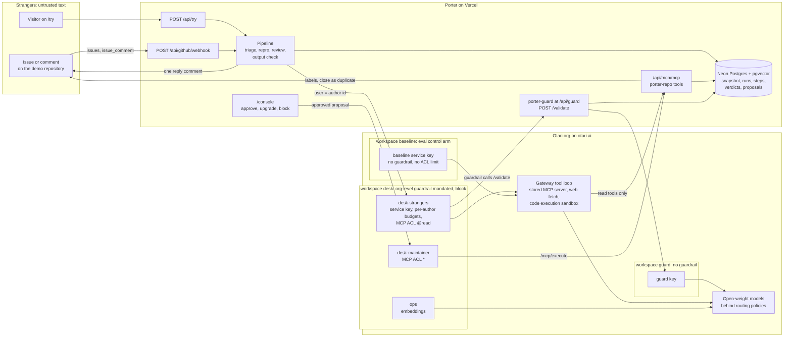

# Architecture

Porter is one Next.js app on Vercel and one Otari org. The app owns intake, the pipeline, the console and two services Otari calls back into: the guardrail service and the MCP server. The org owns everything a stranger can't argue with: which text reaches a model, what each author may spend, which tools a key may call, and which model serves each role.

Every arrow is wired in code and registered outside it: the GitHub App is installed on the demo repository, the stored MCP server `porter-repo` is connected in `desk` and `baseline`, and porter-guard is an org-level guardrail, mandated on workspace `desk`, with its base URL `https://<host>/api/guard` as the endpoint (Otari posts to `/validate` under it). No issue has been answered end to end yet, because the org balance is unfunded; only the guardrail hold path has carried live traffic (see [JUDGES.md](../JUDGES.md#what-is-live)).

## Trust boundaries

| Credential | Workspace | Who causes the call | What it may do |
| --- | --- | --- | --- |
| `desk-strangers` (service key) | desk | every issue, whoever wrote it, every /try visitor, and the Porter arm of the eval and shadow runs | call routing policies under the author's own end-user budget; MCP read tools only (`@read`); every request screened by the org-level guardrail |
| `desk-maintainer` | desk | a maintainer's approval in the console, or `/porter approve` from an owner, member or collaborator | run a pending proposal through `/mcp/execute` (ACL `*`); never sees issue text |
| `ops` | desk | the snapshot and search code | embeddings for the duplicate index; no end users |
| `guard` | guard | porter-guard, when Otari asks it for a verdict | classifier calls only; no guardrail mandated here, so the guard is never screened by itself |
| `baseline` (service key) | baseline | the eval's control arm only | the same pipeline with prompt-only defences: no guardrail, no ACL limit |
| `GUARD_TOKEN` | – | Otari, calling the org-level guardrail | the only way into `/api/guard/validate` |
| `MCP_TOKEN` | – | Otari's gateway | the only way into `/api/mcp/mcp` |

Issue content never travels on the maintainer key. A maintainer account can be compromised too, so an issue from the repository owner gets the same stranger treatment as anyone else's. The maintainer key is used only for a deterministic action a person chose: approving a proposal, in the console or with `/porter approve` (`lib/github/commands.ts`). `/porter upgrade` and `/porter block` go through the strangers key's end-users API, because end users belong to that key.

Writes are limited twice. The gateway withholds write tools from the strangers key, and the MCP server itself refuses writes to any repository that is not the installed demo repository (`write_not_allowed` in `lib/mcp/tools.ts`). The eval and the shadow run target a shadow repository, so no write can leave Porter even if the ACL were misconfigured.

## Data stores

- **Neon Postgres** (`lib/db/schema.ts`, migrations in `drizzle/`): `repos`, `issues` with `qwen3-embedding` vectors (pgvector), `repo_files` and `releases` from the snapshot; `runs`, `steps` (one row per Otari call with the served model, provider, fallback, attempt count, request id, guardrail result, tool calls and cost), `guard_verdicts` (input hash, never the text), `proposals`, `authors` (a 30-second cache of Otari's end users), `eval_results`, and `kv` (delivery ids, rate limits, the review queue, the funds flag).
- **`results/*.json`**, committed: the eval, spam wave and shadow run outputs. `/eval`, `/report/otari`, the front page's figures and the README read their numbers from these files only.
- **Otari** is the source of truth for spend: end-user meters, key budgets, ceilings and per-request cost.

The MCP tools read the snapshot, never live GitHub, so a busy issue tracker costs Porter a handful of GitHub API calls per snapshot (`scripts/snapshot.ts`).

## One request, step by step

1. GitHub delivers `issues.opened`. `app/api/github/webhook/route.ts` checks the HMAC signature, answers 202 and continues in `after()`: it claims the delivery id (a redelivery is a no-op), ignores repositories that are not the installed demo repository, and starts the run.
2. `lib/agent/pipeline.ts` creates a run and makes the triage call on the strangers key: model `porter-triage`, `user: "gh:<login>"`, `Otari-Conversation-Id: run-<id>`, `Otari-Tags: app=porter,role=triage,arm=porter`, `mcp_server_ids: [porter-repo]`, one bare `otari_web_fetch` tool (hosted Otari takes no fetch settings on the request; the workspace's web-fetch policy decides which hosts can be fetched), explicit `max_tokens`.
3. Before any model runs, Otari posts the request text to porter-guard, an org-level guardrail, mandated on workspace `desk`, once per mandated profile: the mandate's endpoint is the base URL `https://<host>/api/guard`, and Otari appends `/validate`. porter-guard answers each with a hard `valid: true` or `false`: deterministic detectors for `secrets`, detectors plus two classifiers on the guard key for `prompt-injection`, Llama Guard 4 for `harm`. On `false`, Otari answers 403 `guardrail_violation`; the run ends held, with a fixed reply. The guardrail screens every call in workspace `desk`, so repro and review are screened as well.
4. Otherwise the routing policy picks the model (tier-down when the author is past 80 % of their budget, the fallback chain when a provider fails), and the gateway runs the tool loop, calling `/api/mcp/mcp` with `MCP_TOKEN` and fetching allowed pages. The response carries `otari_tool_calls` and the `Otari-*` headers, which become a `steps` row.
5. A Python snippet goes to `porter-repro` with `otari_code_execution`. Then `porter-review` writes the reply from the evidence. Then `lib/agent/output-check.ts` checks the reply.
6. `lib/github/post.ts` posts one comment through the GitHub App, with a link to the run's trace; over `WRITES_PER_HOUR` (`lib/ratelimit.ts`) it queues the reply instead of dropping it. Proposed labels and duplicate closes wait in `proposals` until a maintainer approves; `applyProposal` in `lib/github/commands.ts` then fetches the server revision and calls `/mcp/execute` on the maintainer key, with the proposal id as the client execution id. It never retries an execute.

An issue filed on /try starts at step 2 with `user: "web:<hash>"`, where the hash is a daily-salted digest of the visitor's IP. It gets a reply on the page, never proposals.
